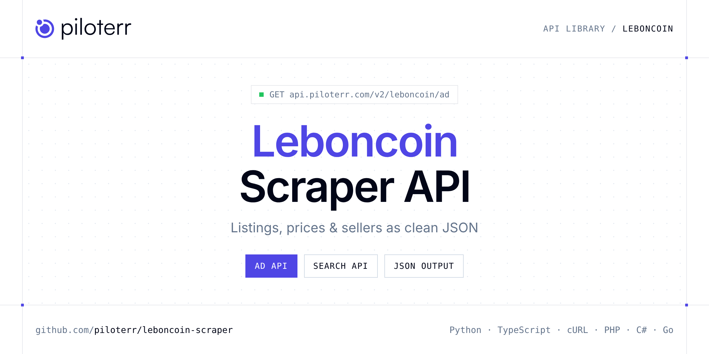

<p align="center">
  <a href="https://www.piloterr.com"></a>
</p>

# Leboncoin Scraper API

[](https://discord.gg/CFj3ph8aHU) [](https://app.piloterr.com) [](https://app.piloterr.com/openapi) [](LICENSE)

The **Piloterr Leboncoin Scraper API** lets you extract public data from Leboncoin as **clean, structured JSON** — no proxies, headless browsers or HTML parsing to maintain. Endpoints available in production:

- **Leboncoin Ad API** — Extract full details from a Leboncoin ad including price, location, attributes, seller info, and images.
- **Leboncoin Search API** — Scrape Leboncoin search results or category pages by URL, returning paginated listings with price, location, and attributes.

Use it for listing monitoring, price benchmarks, stock sourcing or market analytics on second-hand and vehicle marketplaces.

| Endpoint | Path | Credits | What you get |
|---|---|---|---|
| [Leboncoin Ad API](#leboncoin-ad-api) | `/v2/leboncoin/ad` | 1 | Extract full details from a Leboncoin ad including price, location, attributes, seller info, and images. Returns structured JSON by default, or raw HTML on demand. |
| [Leboncoin Search API](#leboncoin-search-api) | `/v2/leboncoin/search` | 1 | Scrape Leboncoin search results or category pages by URL, returning paginated listings with price, location, and attributes. Returns structured JSON. return_page_source is deprecated and returns 400. |

## Table of contents

- [How it works](#how-it-works)
- [Leboncoin Ad API](#leboncoin-ad-api)
- [Leboncoin Search API](#leboncoin-search-api)
- [Code examples in other languages](#code-examples-in-other-languages)
- [Practical use cases](#practical-use-cases)
- [Why Piloterr?](#why-piloterr)
- [FAQ](#faq)
- [Official SDKs](#official-sdks)
- [Related scrapers](#related-scrapers)
- [Support](#support)

## How it works

1. **Create a free Piloterr account** and copy your API key from the [dashboard](https://app.piloterr.com).
2. **Send a `GET` (or `POST`) request** to `https://api.piloterr.com/v2/...` with the header `x-api-key: YOUR_API_KEY`.
3. **Receive structured JSON** — Piloterr handles rendering, proxies, retries and parsing.

```bash
export PILOTERR_API_KEY="your-api-key"
pip install requests        # Python
# TypeScript: Node.js 18+ (native fetch), run with `npx tsx file.ts`
```

> Every endpoint accepts both `GET` (query string) and `POST` (JSON body with the same fields).

## Leboncoin Ad API

Extract full details from a Leboncoin ad including price, location, attributes, seller info, and images. Returns structured JSON by default, or raw HTML on demand.

`GET | POST https://api.piloterr.com/v2/leboncoin/ad` · **1 credit per request** · [Full reference](https://app.piloterr.com/openapi)

### Request parameters

| Parameter | Type | Required | Description |
|---|---|---|---|
| `query` | string | ✅ | Leboncoin ad ID or full ad URL. Both formats are accepted regardless of `return_page_source`. |
| `return_page_source` | boolean | — | Controls the response format. |

### Python example

```python
import json
import os
import requests

response = requests.get(
    "https://api.piloterr.com/v2/leboncoin/ad",
    headers={"x-api-key": os.environ["PILOTERR_API_KEY"]},
    params={
        "query": "3012186547",
    },
    timeout=120,
)
response.raise_for_status()
data = response.json()

print(json.dumps(data, indent=2, ensure_ascii=False)[:2000])
```

### TypeScript example

```typescript
type LeboncoinAd = {
  url?: string;
  body?: string;
  owner?: {
    name?: string;
    type?: string;
    siren?: unknown;
    user_id?: string;
  };
  price?: number[];
  images?: {
    urls?: string[];
  };
  status?: string;
  list_id?: number;
  subject?: string;
  category?: {
    id?: string;
    label?: string;
  };
  location?: {
    lat?: number;
    lng?: number;
    city?: string;
    zipcode?: string;
    region_id?: string;
    region_name?: string;
    department_id?: string;
    department_name?: string;
  };
  attributes?: {
    key?: string;
    value?: string;
    value_label?: string;
  }[];
  price_cents?: number[];
  creation_date?: string;
  expiration_date?: string;
};

const params = new URLSearchParams({
  "query": "3012186547",
});

const response = await fetch(`https://api.piloterr.com/v2/leboncoin/ad?${params}`, {
  headers: { "x-api-key": process.env.PILOTERR_API_KEY! },
});
if (!response.ok) throw new Error(`Piloterr error ${response.status}: ${await response.text()}`);

const data = (await response.json()) as LeboncoinAd;

console.log(JSON.stringify(data, null, 2).slice(0, 2000));
```

<details>
<summary><b>POST variant</b></summary>

```http
POST https://api.piloterr.com/v2/leboncoin/ad
x-api-key: YOUR_API_KEY
Content-Type: application/json

{"query": "3012186547"}
```
</details>

### Output example

Example response from the API reference, abridged — real values depend on the page you scrape.

```json
{
  "url": "https://www.leboncoin.fr/voitures/2715494476.htm",
  "body": "Renault Clio IV 1.5 DCI 90. Carnet d'entretien complet, CT OK, première main.",
  "owner": {
    "name": "example",
    "type": "example",
    "siren": null,
    "user_id": "example"
  },
  "price": [
    8500
  ],
  "images": {
    "urls": [
      "https://img.leboncoin.fr/api/cdn/thumbs/abcdef1234567890.jpg"
    ]
  },
  "status": "active",
  "list_id": 2715494476,
  "subject": "Renault Clio IV 1.5 DCI 90 Energy SL Rip Curl",
  "category": {
    "id": "2",
    "label": "Voitures"
  },
  "location": {
    "lat": 44.8378,
    "lng": -0.5792,
    "city": "Bordeaux",
    "zipcode": "33000",
    "region_id": "14",
    "region_name": "Nouvelle-Aquitaine",
    "department_id": "33",
    "department_name": "Gironde"
  },
  "attributes": [
    {
      "key": "regdate",
      "value": "2015",
      "value_label": "2015"
    },
    {
      "key": "mileage",
      "value": "95000",
      "value_label": "95 000 km"
    }
  ],
  "price_cents": [
    850000
  ],
  "creation_date": "2024-09-15T14:22:00+02:00",
  "expiration_date": "2024-10-15T14:22:00+02:00"
}
```

### Response fields

| Field | Type | Description |
|---|---|---|
| `url` | string |  |
| `body` | string |  |
| `owner` | object |  |
| `owner.name` | string |  |
| `owner.type` | string |  |
| `owner.siren` | object |  |
| `owner.user_id` | string |  |
| `price` | integer[] |  |
| `images` | object |  |
| `images.urls` | string[] |  |
| `status` | string |  |
| `list_id` | integer |  |
| `subject` | string |  |
| `category` | object |  |
| `category.id` | string |  |
| `category.label` | string |  |
| `location` | object |  |
| `location.lat` | number |  |
| `location.lng` | number |  |
| `location.city` | string |  |
| `location.zipcode` | string |  |
| `location.region_id` | string |  |
| `location.region_name` | string |  |
| `location.department_id` | string |  |
| `location.department_name` | string |  |

## Leboncoin Search API

Scrape Leboncoin search results or category pages by URL, returning paginated listings with price, location, and attributes. Returns structured JSON. return_page_source is deprecated and returns 400.

`GET | POST https://api.piloterr.com/v2/leboncoin/search` · **1 credit per request** · [Full reference](https://app.piloterr.com/openapi)

### Request parameters

| Parameter | Type | Required | Description |
|---|---|---|---|
| `query` | string | ✅ | Full Leboncoin search or category URL. Both keyword searches and category browse URLs are supported. |
| `return_page_source` | boolean | — | Deprecated. Sending true returns 400. |

### Python example

```python
import json
import os
import requests

response = requests.get(
    "https://api.piloterr.com/v2/leboncoin/search",
    headers={"x-api-key": os.environ["PILOTERR_API_KEY"]},
    params={
        "query": "https://www.leboncoin.fr/c/offres_d_emploi?locations=Paris_75015__48.84105_2.29926_2747",
    },
    timeout=120,
)
response.raise_for_status()
data = response.json()

print(json.dumps(data, indent=2, ensure_ascii=False)[:2000])
```

### TypeScript example

```typescript
type LeboncoinSearch = {
  ads?: {
    url?: string;
    body?: string;
    owner?: {
      name?: string;
      type?: string;
    };
    price?: number[];
    images?: {
      nb_images?: number;
      small_url?: string;
    };
    status?: string;
    list_id?: number;
    subject?: string;
    location?: {
      city?: string;
      zipcode?: string;
      region_name?: string;
      department_name?: string;
    };
    attributes?: {
      key?: string;
      value?: string;
      value_label?: string;
    }[];
    category_id?: string;
    category_name?: string;
    creation_date?: string;
  }[];
  total?: number;
  pagination?: {
    page?: number;
    total_pages?: number;
  };
};

const params = new URLSearchParams({
  "query": "https://www.leboncoin.fr/c/offres_d_emploi?locations=Paris_75015__48.84105_2.29926_2747",
});

const response = await fetch(`https://api.piloterr.com/v2/leboncoin/search?${params}`, {
  headers: { "x-api-key": process.env.PILOTERR_API_KEY! },
});
if (!response.ok) throw new Error(`Piloterr error ${response.status}: ${await response.text()}`);

const data = (await response.json()) as LeboncoinSearch;

console.log(JSON.stringify(data, null, 2).slice(0, 2000));
```

<details>
<summary><b>POST variant</b></summary>

```http
POST https://api.piloterr.com/v2/leboncoin/search
x-api-key: YOUR_API_KEY
Content-Type: application/json

{"query": "https://www.leboncoin.fr/c/offres_d_emploi?locations=Paris_75015__48.84105_2.29926_2747"}
```
</details>

### Output example

Example response from the API reference, abridged — real values depend on the page you scrape.

```json
{
  "ads": [
    {
      "url": "https://www.leboncoin.fr/voitures/2718234567.htm",
      "body": "Renault Megane IV Estate diesel, CT valable 2 ans, révision à jour, non fumeur.",
      "owner": {
        "name": "example",
        "type": "example"
      },
      "price": [
        9900
      ],
      "images": {
        "nb_images": 8,
        "small_url": "https://img.leboncoin.fr/api/cdn/thumbs/xyz12345.jpg"
      },
      "status": "active",
      "list_id": 2718234567,
      "subject": "Renault Megane IV Estate 1.5 DCI 110 Business",
      "location": {
        "city": "Versailles",
        "zipcode": "78000",
        "region_name": "Île-de-France",
        "department_name": "Yvelines"
      },
      "attributes": [
        {},
        {}
      ],
      "category_id": "2",
      "category_name": "Voitures",
      "creation_date": "2024-09-18T09:30:00+02:00"
    }
  ],
  "total": 12481,
  "pagination": {
    "page": 1,
    "total_pages": 100
  }
}
```

### Response fields

| Field | Type | Description |
|---|---|---|
| `ads[]` | object[] |  |
| `ads[].url` | string |  |
| `ads[].body` | string |  |
| `ads[].owner` | object |  |
| `ads[].price` | integer[] |  |
| `ads[].images` | object |  |
| `ads[].status` | string |  |
| `ads[].list_id` | integer |  |
| `ads[].subject` | string |  |
| `ads[].location` | object |  |
| `ads[].attributes[]` | object[] |  |
| `ads[].category_id` | string |  |
| `ads[].category_name` | string |  |
| `ads[].creation_date` | string |  |
| `total` | integer |  |
| `pagination` | object |  |
| `pagination.page` | integer |  |
| `pagination.total_pages` | integer |  |

## Code examples in other languages

Ready-to-run examples live in the [`examples/`](examples) folder. Each one reads your key from the `PILOTERR_API_KEY` environment variable.

| Language | Ad | Search |
|---|---|---|
| cURL (Bash) | [`ad`](examples/curl/ad.sh) | [`search`](examples/curl/search.sh) |
| PHP | [`ad`](examples/php/ad.php) | [`search`](examples/php/search.php) |
| C# | [`ad`](examples/csharp/Ad.cs) | [`search`](examples/csharp/Search.cs) |
| Go | [`ad`](examples/go/ad.go) | [`search`](examples/go/search.go) |
| Java | [`ad`](examples/java/AdExample.java) | [`search`](examples/java/SearchExample.java) |
| Ruby | [`ad`](examples/ruby/ad.rb) | [`search`](examples/ruby/search.rb) |
| Node.js | [`ad`](examples/nodejs/ad.mjs) | [`search`](examples/nodejs/search.mjs) |

## Practical use cases

- **Listing monitoring** — Get alerted when new ads matching your criteria are published.
- **Price benchmarks** — Compute market prices per model, category or location.
- **Sourcing** — Find stock, vehicles, parts or equipment faster than manual browsing.
- **Market analytics** — Measure supply, turnover and pricing trends over time.
- **Data products** — Feed valuation models and dashboards with structured listings.

## Why Piloterr?

- **No infrastructure** — no proxies, headless browsers or CAPTCHA solving to run yourself.
- **Structured JSON** — stable, documented fields instead of brittle HTML selectors.
- **Pay per request** — transparent credit cost per endpoint, failed requests are retried for you.
- **One API key, hundreds of sources** — Leboncoin plus many other e-commerce, search and company data endpoints in the [Piloterr library](https://www.piloterr.com/library).
- **Any language** — plain HTTPS + JSON, with examples for Python, TypeScript, cURL, PHP, C#, Go, Java, Ruby and Node.js.

## FAQ

### Is it legal to scrape Leboncoin?

Collecting publicly available data is generally allowed in many jurisdictions, but rules depend on your country, the data you collect and how you use it. Avoid personal data unless you have a lawful basis, respect the website's terms where they apply, and get legal advice for your specific use case. This is not legal advice.

### Do I need proxies or a headless browser?

No. Piloterr handles rendering, proxy rotation and retries on its side. You only send an HTTPS request with your `x-api-key` header and receive JSON.

### How much does a request cost?

Credits per call: `/v2/leboncoin/ad` **1**, `/v2/leboncoin/search` **1**. See the [Piloterr website](https://www.piloterr.com) for plans.

### What data does the Leboncoin API return?

Each endpoint returns structured JSON: **Leboncoin Ad** — `url`, `body`, `owner`, `owner.name`, `owner.type`, `owner.siren`; **Leboncoin Search** — `ads[]`, `ads[].url`, `ads[].body`, `ads[].owner`, `ads[].price`, `ads[].images`.

### Can I get the raw HTML instead of JSON?

Yes. Set `return_page_source=true` and the response becomes `{"result": "..."}` with the page source.

### Which languages are supported?

Any language that can make an HTTP request. This README shows Python and TypeScript; the [`examples/`](examples) folder contains cURL, PHP, C#, Go, Java, Ruby and Node.js.

## Official SDKs

Use Piloterr from your own language with a typed client:

| SDK | Package | Install |
| --- | --- | --- |
| Node.js | [`@piloterr/sdk`](https://www.npmjs.com/package/@piloterr/sdk) | `npm install @piloterr/sdk` |
| Python | [`piloterr`](https://pypi.org/project/piloterr/) | `pip install piloterr` |
| Go | [`piloterr-go`](https://pkg.go.dev/github.com/piloterr/piloterr-go) | `go get github.com/piloterr/piloterr-go` |
| .NET | [`Piloterr`](https://www.nuget.org/packages/Piloterr) | `dotnet add package Piloterr` |
| Ruby | [`piloterr`](https://rubygems.org/gems/piloterr) | `gem install piloterr` |
| PHP | [`piloterr/sdk`](https://packagist.org/packages/piloterr/sdk) | `composer require piloterr/sdk` |
| Java | [`piloterr-java`](https://github.com/piloterr/piloterr-java) | build from source, see its README |
| CLI | [`@piloterr/cli`](https://www.npmjs.com/package/@piloterr/cli) | `npm install -g @piloterr/cli` |
| MCP server | [`@piloterr/mcp`](https://www.npmjs.com/package/@piloterr/mcp) | `npx -y @piloterr/mcp` |

## Related scrapers

- [AutoScout24 Scraper API](https://github.com/piloterr/autoscout24-scraper)
- [Autotrader Scraper API](https://github.com/piloterr/autotrader-scraper)
- [Copart Scraper API](https://github.com/piloterr/copart-scraper)
- [Kijiji Scraper API](https://github.com/piloterr/kijiji-scraper)
- [Mascus Scraper API](https://github.com/piloterr/mascus-scraper)
- [mobile.de Scraper API](https://github.com/piloterr/mobile-de-scraper)
- [All Piloterr scrapers on GitHub](https://github.com/piloterr)

## Support

- 💬 Join the [Piloterr Discord](https://discord.gg/CFj3ph8aHU) to ask questions and share what you build.
- 📚 Browse the [API reference (OpenAPI)](https://app.piloterr.com/openapi) and the [Piloterr library](https://www.piloterr.com/library).
- 🔑 [Get your API key](https://app.piloterr.com).

---

<p align="center">
  <a href="https://www.piloterr.com">
    <picture>
      <source media="(prefers-color-scheme: dark)" srcset="images/logo-dark.svg">
      
    </picture>
  </a>
  <br>
  <sub>Built by <a href="https://www.piloterr.com">Piloterr</a> — web scraping APIs for e-commerce, search, real estate and more, one API key.</sub>
</p>

<sub>Leboncoin is a trademark of its respective owner. This repository is not affiliated with or endorsed by Leboncoin. Examples are released under the MIT license.</sub>
